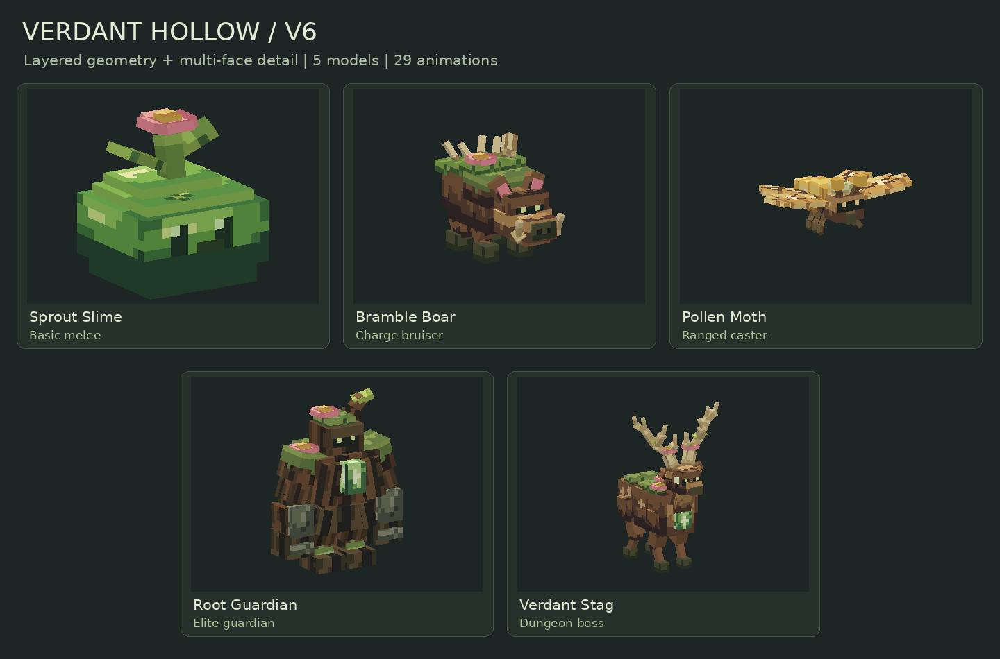
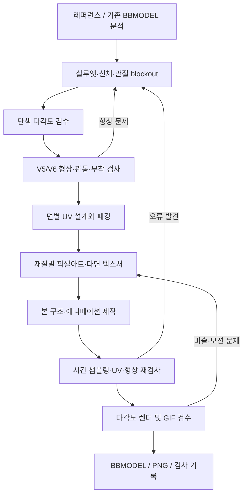
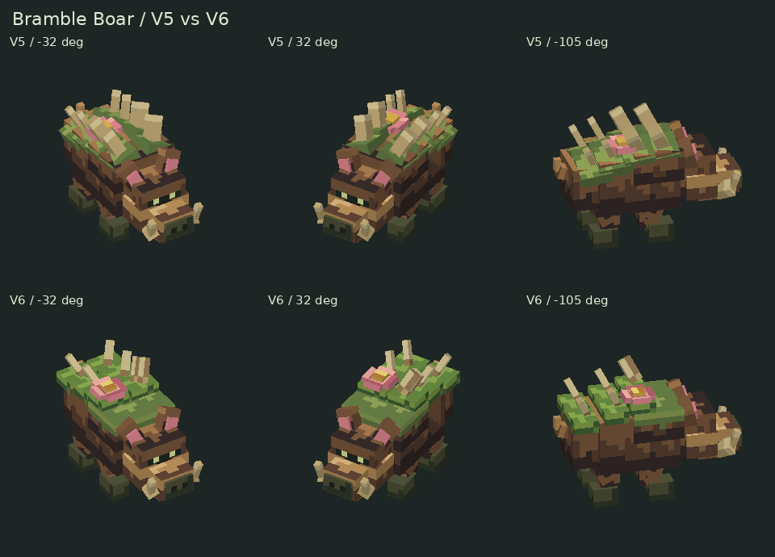

# Blockbench Texture Artist V6

[English](README.md) · **한국어** · [변경 이력](CHANGELOG.md) · [스킬 다운로드](blockbench-texture-artist.zip)

Minecraft 몬스터, 보스, 인간형 캐릭터, 무기 및 장비를 위한 **AI 에이전트용 Blockbench 모델 제작·검수 스킬**입니다. 단순히 큐브와 텍스처를 생성하는 것이 아니라, 형태 설계부터 면별 UV, 픽셀아트, 본 구조, 애니메이션, 3D 표면 무결성까지 일관된 제작 절차를 제공합니다.



> 이 프로젝트는 Blockbench 플러그인이나 독립적인 모델 자동 생성 프로그램이 아닙니다. `SKILL.md`의 제작 지침, 세부 참고 문서 및 Python 검사 도구를 AI 에이전트가 함께 사용하는 방식입니다. 편집 가능한 `.bbmodel`이 목표이며 컨셉 이미지는 이를 대체하지 않습니다.

## 목차

- [제작 철학과 전체 워크플로우](#제작-철학과-전체-워크플로우)
- [1. 형태·본·의복 설계](#1-형태본의복-설계)
- [2. 면별 UV와 텍스처 아틀라스](#2-면별-uv와-텍스처-아틀라스)
- [3. 픽셀아트와 다면 재질 표현](#3-픽셀아트와-다면-재질-표현)
- [4. 무기와 전투 애니메이션](#4-무기와-전투-애니메이션)
- [5. Z-fighting 검사 원리](#5-z-fighting-검사-원리)
- [6. 입체 관통과 부착 검사 원리](#6-입체-관통과-부착-검사-원리)
- [7. 설치와 검사 도구 사용법](#7-설치와-검사-도구-사용법)
- [8. 실제 제작 예제](#8-실제-제작-예제)
- [9. 제한사항과 배포](#9-제한사항과-배포)

## 제작 철학과 전체 워크플로우

**실루엣이 먼저, 텍스처는 그다음.** 장식의 개수, UV 공유율, 자동 검사 통과 여부만으로 미술적 완성도를 평가하지 않습니다. 형태와 실제 게임 거리에서의 가독성을 먼저 확보하고, 불필요한 geometry를 줄인 뒤 수치 검사와 시각 검수를 병행합니다.



원본 수정 시 먼저 백업하고, 요청 범위 밖의 모델링·UV·본·애니메이션은 보존합니다. 새 큐브를 추가하거나 치수를 변경할 때는 모든 관련 검사를 다시 실행합니다.

## 1. 형태·본·의복 설계

### Primary / Secondary / Tertiary

| 단계 | 의미 | 적용 예시 |
|---|---|---|
| Primary | 큰 덩어리와 실루엣 | 몸통, 머리, 복부, 망토 |
| Secondary | 실제 입체 구조와 기능 | 관절, 갑각, 뿔, 손잡이, 금속 연결부 |
| Tertiary | 표면 디테일 | 룬, 털, 나뭇결, 음각, 마모 |

기본 형태의 결함을 작은 큐브로 덮지 않습니다. 인간형은 흉곽·허리·골반의 폭과 깊이, 손목·팔꿈치·무릎의 위치를 먼저 설정합니다. 일반적인 6~8두신은 출발점일 뿐이며 Minecraft 스타일과 레퍼런스를 우선합니다. 동물형은 종별 체형과 보행 방식이 우선입니다.

망토는 어깨나 목의 고정점에서 시작하는 넓은 천 면을 사용하고, 구간별 폭·각도·깊이를 조절합니다. 주름과 봉제선은 대부분 텍스처로 표현합니다. 뿔과 가지는 두꺼운 뿌리에서 얇은 끝으로 이어지게 설계합니다.

### Anti-line-cube

큐브의 변 길이를 `a ≤ b ≤ c`로 정렬할 때 `c ≥ 12`이고 `c/b ≥ 3`이면 장척 검토 대상으로 분류합니다. 천 관련 이름의 큐브는 비율 4 이상에서 강한 경고를 표시합니다. 이는 엔진 제한이 아닌 휴리스틱입니다. 검, 지팡이, 팔다리처럼 길이가 필요한 부품은 역할과 형태를 검토하여 예외를 기록합니다.

### 본 계층과 피벗

큐브는 실제 움직임을 담당하는 본에 연결하고 pivot은 관절 또는 부착 중심에 둡니다. 수정 시 UUID, 부모 본, 애니메이션 트랙을 보존합니다. 장식을 복원할 때 root에 임의로 붙이지 않습니다. 머리·다리·장식의 연결을 기본 자세뿐 아니라 움직이는 자세에서도 검사합니다.

## 2. 면별 UV와 텍스처 아틀라스

### 2.1 로컬 치수와 UV의 대응

큐브의 회전 전 치수를 `X × Y × Z`라고 하면 각 면의 UV 크기는 다음과 같습니다. 기본 픽셀 밀도는 **1 model unit : 1 texel**입니다.

| 면 | 실제 치수 | 8×12×4 큐브의 UV 예 |
|---|---|---|
| north / south | X × Y | 8×12 px |
| east / west | Z × Y | 4×12 px |
| up / down | X × Z | 8×4 px |

공통 밀도 `d`에서는 각 치수에 `d`를 곱합니다. UV 자체가 90°/270° 회전한 경우에는 폭과 높이 대응을 교환합니다. 큐브가 3D 공간에서 회전하더라도 원래 로컬 면의 크기는 바뀌지 않습니다. 소수 치수가 필요하면 공통 격자와 밀도를 조정하고 예외를 기록합니다.

### 2.2 의도적 UV 재사용

같은 크기, 재질, 방향 및 그림 의도를 가진 면만 동일 UV 사각형을 공유합니다. 대칭 공유는 가능하지만 얼굴, 읽는 방향이 있는 룬, 고유 손상 등은 독립 영역을 사용합니다. 공유 영역을 변경할 때 다른 부품에 영향이 생기면 새 UV 섬으로 복제(copy-on-write)합니다.

정확히 동일한 UV 사각형의 공유는 허용하지만 서로 다른 영역의 부분 중첩은 금지합니다. UV 공유와 3D 면 중첩은 전혀 다른 문제입니다. 패킹 시 재사용과 배치 최적화를 우선하고, 부족하면 아틀라스를 확장합니다. 개별 면을 늘리거나 축소해 공간을 맞추지 않습니다. 가능하면 1px 가장자리 패딩을 확보합니다.

| 제작 설정 | 권장 시작값 |
|---|---|
| 일반 몬스터 | 64×64 또는 128×128 |
| 대형 몬스터 / 보스 | 128×128 또는 256×256 |
| 필터링 | Nearest Neighbor |
| 파일 | RGBA PNG, 가능하면 BBMODEL 내부 내장 |
| 알파 | 일반 불투명 255, 빈 공간 0; 의도적 투명 효과는 별도 검토 |

## 3. 픽셀아트와 다면 재질 표현

재질마다 기본 4~7색의 제한된 팔레트에서 시작합니다. 기본색 → 큰 명암 군집 → 표면 패턴 → 모서리·접촉 음영 → 손상과 문양 순으로 작업합니다. Hue shifting, 국소적인 baked AO, 불규칙한 pixel clustering을 사용하되 불필요한 노이즈와 반복적인 테두리, 흐릿한 그라데이션을 피합니다. 절차적 생성 시 seed를 기록합니다.

| 재질 | 표현 방식 |
|---|---|
| 나무·뼈 | 방향성 결, 단면, 접합부 음영 |
| 석재 | 넓고 각진 색면, 선택적 균열 |
| 이끼·잎 | 면을 가로지르는 색면, 잎맥, 어두운 밑층 |
| 금속 | 제한적인 날카로운 하이라이트와 모서리 명암 |
| 천·가죽 | 낮은 대비의 결, 연결되는 주름과 봉제선 |
| 수정 | 면마다 다른 색면, 선택적 반사광과 어두운 단면 |

밝은 텍스처 픽셀은 실제 emissive 효과와 다릅니다. 발광은 대상 엔진이 지원하는 별도 방식이 확인될 때만 적용합니다.

### V6: Multi-Face Readability

중요한 장식은 정면뿐 아니라 측면, 상면, 후면, 사선에서도 재질과 부피가 읽혀야 합니다. 그렇다고 모든 면에 동일한 문양을 복제하거나 큐브를 더 붙이지는 않습니다.

- **Flat decal:** 잎맥, 흠집, 얕은 이끼는 지지체의 텍스처에 직접 표현.
- **Thin plate:** 넓은 면에는 주요 문양, 측면에는 단면색과 제한적 모서리 명암, 뒷면에는 재질에 맞는 음영. 1~2px 폭을 강제로 확대하지 않음.
- **Solid ornament:** 수정의 면, 목재의 단면, 꽃잎의 뒷면처럼 실제 부피에 따른 재질 변화 표현.

`check_multiface_readability.py`는 정책에 지정한 면의 색상 수, 휘도 범위, 지배색 비율을 측정합니다. 실제 코드에서 유효 픽셀 4개 이상 등 조건을 충족한 면에 단색, 휘도 범위 8 미만, 또는 지배색 비율 95% 초과 시 경고를 냅니다. 작은 면의 단색은 의도적일 수 있습니다. 검사 수치를 맞추기 위해 무작위 픽셀을 추가하지 않습니다. 이 도구는 UV 경계의 미술적 연속성이나 가시성을 증명하지 않으므로 확대 렌더와 게임 거리 검수를 병행합니다.

## 4. 무기와 전투 애니메이션

무기는 기본 실루엣, 연결부·보석·그립, 룬·음각의 세 단계로 설계합니다. 얕은 룬은 텍스처, 실제 돌출 구조는 큐브로 표현합니다. 전후좌우에서 불필요하게 튀어나온 보조 큐브를 검사합니다. 코어, 금속 프레임, 가죽 등 재질을 구분합니다.

```text
torso
└── upper_arm
    └── forearm
        └── hand
            └── weapon
                └── optional_core_or_decoration
```

손목 pivot과 무기 그립 pivot은 각각 실제 위치에 둡니다. 검은 검날 및 날 방향, 창은 찌르는 방향, 지팡이는 시전 방향을 기준으로 자세를 설계합니다. 양손 무기에서는 두 손의 접촉을 유지합니다. 상완과 전완의 움직임을 고려하여 손목을 보정하며, 필요하면 IK를 계산해 키프레임으로 베이크합니다. 이 저장소 자체가 범용 IK 솔버나 Mixamo 리타게팅 프로그램을 제공하는 것은 아닙니다.

### 전투 모션의 네 단계

| 단계 | 설계 원리 |
|---|---|
| Anticipation | 공격을 읽을 수 있는 예비 동작, 체중 이동 |
| Strike | 무기 궤적을 먼저 결정하고 빠르게 가속 |
| Follow-through | 관성, 골반·상체 회전, 망토의 지연 반응 |
| Recovery | 균형 회복 및 다음 대기 자세로 연결 |

대검의 낮은 가드와 지팡이의 수직 자세를 구분합니다. 지지발 접지, 공격 방향, 체중, 무기 끝과 날의 경로, 손목 각도를 확인합니다. 최소 20Hz와 키프레임 시점의 수치 검사를 수행하고, 빠른 동작은 더 촘촘한 검사와 실제 GIF/재생 확인을 권장합니다. 모션 참조의 이름만 확인한 것을 실제 모션 데이터 확보나 리타게팅으로 표현하지 않습니다.

## 5. Z-fighting 검사 원리

동일하거나 매우 가까운 평면에 두 표면이 겹치면 깊이 버퍼가 어느 쪽을 그릴지 안정적으로 결정하지 못해 깜빡임이 발생할 수 있습니다. V5는 큐브의 단순 AABB 비교가 아닌 **변환된 면의 평면 및 실제 중첩 면적**을 분석합니다.

1. 각 큐브의 여덟 꼭짓점과 면을 구성하고 pivot 회전, 부모 본 변환, 수치형 선형 애니메이션을 적용합니다.
2. AABB로 후보를 줄인 뒤 면의 법선과 평면 거리를 계산합니다.
3. 평행 또는 거의 평행한 면을 공통 2D 평면에 투영하고 볼록 다각형 클리핑으로 양의 중첩 면적을 구합니다.
4. 동일 방향의 정확한 중첩 / 근접 평면 / 반대 방향 접촉을 구분합니다. 기본 자세와 샘플링한 모션에 대해 반복합니다.

| 분석 기준 | V5/V6 기본값 |
|---|---|
| 정확 평면 거리 | ≤ 0.0001 unit |
| 근접 평면 거리 | ≤ 0.10 unit |
| 평행·반평행 법선 허용 범위 | 0.1° 이내 |
| 최소 중첩 면적 | > 0.00001 unit² |

수치는 분석 기준이며 보편적인 GPU 안전 마진이 아닙니다. 반대 방향 접촉은 내부 결합부일 수 있으므로 별도 기록합니다. 무작정 모든 큐브를 일정량 이동하는 대신, 표면의 주체를 하나로 정하고 연결부 폭, 경계, 장식 깊이를 수정합니다. 치수가 바뀌면 UV를 재설계합니다.

## 6. 입체 관통과 부착 검사 원리

서로 다른 각도의 큐브가 상대 표면을 뚫고 나오면 Z-fighting이 없어도 모델이 깨져 보일 수 있습니다. V6에서는 **입체 교차 / 보호 표면 / 부착 연결**을 함께 검토합니다.



### 6.1 Surface penetration

변환된 큐브의 세 모서리 벡터로 로컬 기저를 구성하고 역행렬로 상대 표면을 단위 상자 좌표계에 옮깁니다. 그 면을 단위 상자의 내부를 정의하는 여섯 반공간에 대해 클리핑합니다. 잘린 다각형 면적을 원래 면적과 비교하여 상대 입체 안에 들어간 **쌍별 표면 면적 비율**을 계산합니다. 회전 및 비균일 스케일을 포함하는 수치형 affine 변환을 다루지만, 합집합 면적이나 실제 화면 가시성을 계산하는 것은 아닙니다.

기본 자세에서는 텍스처가 있는 모든 면을 검사하고, 애니메이션 중에는 정책으로 지정한 `protected_faces`를 검사합니다. 갑각 윗면은 보호하고 밑면은 지지체에 적절히 매립할 수 있습니다. 가시와 꽃의 뿌리처럼 의도적으로 가려지는 부위는 상대 큐브를 이름으로 명시합니다. 완전히 묻힌 면이나 내부 관절 중첩이 모두 오류인 것은 아닙니다.

```json
{
  "bramble_plate_-1_2": {
    "protected_faces": ["up"],
    "allow": {"up": ["thorn_-1_2"]},
    "detail_faces": ["north", "south", "east", "west", "up"]
  }
}
```

위 예는 실제 멧돼지 정책의 일부입니다. 신규 모델에서는 실제 큐브 이름과 보호 면을 직접 지정해야 합니다. 빈 정책은 검사 통과가 아닙니다.

### 6.2 Attachment integrity — SAT

장식을 위로 이동해 관통을 해소하는 과정에서 공중에 뜨는 문제를 방지합니다. SAT(Separating Axis Theorem)는 두 변환된 상자의 면 법선 및 모서리 교차축으로 투영 구간을 비교합니다. 분리 축이 있고 최대 축 간격이 허용치(기본 0.08 unit)를 초과하면 부착 후보 경고를 기록합니다. 이 값은 실제 유클리드 최단거리나 물리적 지지력의 보장이 아닙니다.

```json
{
  "thorn_-1_2": ["bramble_plate_-1_2"]
}
```

지정된 지지체 중 하나와의 접촉 여부를 검사합니다. 모든 큐브의 부착을 자동 추론하지 않습니다. 원래 부모 본과 실제 접촉 영역도 시각적으로 확인해야 합니다.

## 7. 설치와 검사 도구 사용법

### 환경

- 목표: Minecraft Java Edition, Paper 1.21.4, ModelEngine 4, Blockbench. 다른 버전의 호환성은 별도 확인.
- 스킬을 읽고 파일을 생성할 수 있는 AI 에이전트.
- 검사 도구: Python, NumPy, SciPy, Pillow. GitHub Actions는 Python 3.11을 사용하도록 구성되어 있습니다.

[스킬 ZIP](blockbench-texture-artist.zip)을 스킬 지원 환경에 등록하거나 `SKILL.md`, `references/`, `scripts/`를 함께 작업 컨텍스트로 제공하세요. 실행 환경에 따라 설치 방법이 다릅니다. 예시 프롬프트:

> Blockbench Texture Artist V6를 사용해 첨부 레퍼런스 기반의 몬스터 BBMODEL을 제작해 줘. 1:1 면별 UV, 의도적 공유, 애니메이션 및 V5/V6 검사 결과를 포함하고, 실제 런타임 검수 여부를 명시해 줘.

저장소 루트에서 다음 명령을 실행합니다. 실제 예제 경로를 사용하므로 별도 정책을 새로 작성하지 않아도 됩니다.

```bash
python -m pip install -r requirements.txt
python -m unittest discover -s scripts -p 'test_*.py' -v
python scripts/check_geometry.py examples/meadow-dungeon-v6/thorn_boar/thorn_boar.bbmodel
python scripts/check_uv.py examples/meadow-dungeon-v6/thorn_boar/thorn_boar.bbmodel
python scripts/check_z_fighting.py examples/meadow-dungeon-v6/thorn_boar/thorn_boar.bbmodel --hz 20 --strict-near
python scripts/check_interpenetration.py examples/meadow-dungeon-v6/thorn_boar/thorn_boar.bbmodel --policy examples/meadow-dungeon-v6/thorn_boar/surface_policy.json --hz 20
python scripts/check_attachment.py examples/meadow-dungeon-v6/thorn_boar/thorn_boar.bbmodel --policy examples/meadow-dungeon-v6/thorn_boar/attachment_policy.json --hz 20
python scripts/check_multiface_readability.py examples/meadow-dungeon-v6/thorn_boar/thorn_boar.bbmodel --policy examples/meadow-dungeon-v6/thorn_boar/surface_policy.json
```

각 검사기는 `--output report.json`으로 보고서를 저장할 수 있습니다. `--hz`를 생략하면 V5/V6 면·부착 검사는 기본 자세만 검사합니다. 무기 모델에서는 `python scripts/check_weapon_grip.py MODEL.bbmodel --config CONFIG.json --hz 20`을 추가 사용하세요. [그립 정책 예시](references/grip-config.example.json)는 대상 모델의 본과 좌표에 맞게 변경해야 합니다.

| 검사기 | 실제 검사 범위 |
|---|---|
| `check_geometry.py` | 로컬 장척 비율 및 이름 기반 천 휴리스틱 |
| `check_uv.py` | 정수 UV, 로컬 면 크기·밀도, 범위, 텍스처 참조, 부분 중첩 |
| `check_weapon_grip.py` | 수치형 그립/무기 축/지면/OBB 검토 |
| `check_z_fighting.py` | 변환된 면의 동일·근접 평면 중첩 |
| `check_interpenetration.py` | 기본 자세의 텍스처 면 및 모션 중 지정 보호 면의 상대 입체 포함 비율 |
| `check_attachment.py` | 정책 지정 지지체의 SAT 분리 축 간격 |
| `check_multiface_readability.py` | 지정 UV 면의 색상·휘도 휴리스틱 |

일부 검사기는 경고를 JSON으로만 출력합니다. 종료 코드 0이 모든 미술·구조 검수를 통과했다는 뜻은 아닙니다. 보고서의 `unsupported`, `issues`, `warnings`, `errors` 및 적용 범위를 직접 확인하세요.

### 저장소 구성

```text
SKILL.md                         # AI 에이전트가 따라야 할 제작 절차
references/                      # 분야별 상세 지침과 그립 정책 예시
scripts/                         # Python 검사기와 단위 테스트
examples/meadow-dungeon-v6/       # 모델 5종, 텍스처, GIF, 정책, JSON 보고서
.github/workflows/tests.yml       # GitHub Actions 단위 테스트 설정
requirements.txt
blockbench-texture-artist.zip     # 스킬 등록용 압축 파일
```

## 8. 실제 제작 예제

[초원 던전 V6](examples/meadow-dungeon-v6/README.md)는 총 5종의 편집 가능한 모델과 29개 애니메이션을 제공합니다. 모델별 정책과 검사 기록을 포함합니다.

| 몬스터 | 큐브 | 애니메이션 | 주요 특징 |
|---|---:|---:|---|
| [새싹 슬라임](examples/meadow-dungeon-v6/meadow_slime/) | 12 | 5 | 도약, 잎의 단면 |
| [가시 멧돼지](examples/meadow-dungeon-v6/thorn_boar/) | 53 | 6 | 분리된 등 갑각, 돌진 |
| [꽃가루 나방](examples/meadow-dungeon-v6/pollen_moth/) | 34 | 6 | 독립 날개, 비행 |
| [뿌리 수호자](examples/meadow-dungeon-v6/root_guardian/) | 49 | 6 | 오른팔 휘두르기, 이끼 텍스처 통합 |
| [수호 사슴](examples/meadow-dungeon-v6/verdant_stag/) | 90 | 6 | 등 장식, 마력 결정, 뿔 공격 |

### 기록된 검사 결과

[실제 validation_all.json](examples/meadow-dungeon-v6/validation_all.json) 기준:

| 항목 | 결과 |
|---|---:|
| 큐브 / 텍스처 면 | 238 / 1,428 |
| 고유 UV 영역 / 공유 면 | 365 / 1,063 (74.4%) |
| 기본 자세 및 모션 샘플 | 1,249 |
| 지정 보호 면 | 16 |
| 지정 보호 면 관통 후보 (기본 자세) | 35 → 0 |
| 샘플링한 동일 방향 정확·근접 평면 중첩 후보 | 0 |
| 샘플링한 지정 보호 면 관통 후보 | 0 |
| 지정 다면 텍스처 면 / 경고 | 400 / 0 |
| 지정 부착부 / 경고 | 41 / 0 |
| UV 오류 | 0 |

이 수치는 이전 V6 제작 과정의 기록이며, 모든 표면이 모든 프레임에서 무결함이라는 뜻이 아닙니다. 기본 자세에는 부분/완전 포함 후보 2,904/82건이 남아 있고, 반대 방향 접촉은 샘플 중복 포함 2,394건입니다. 허용 접촉과 숨은 면을 별도로 검토해야 합니다. 슬라임과 나방에는 지정 보호 면과 부착 정책 항목이 없으므로 해당 애니메이션 검사 범위를 주장하지 않습니다. V5 대비 애니메이션 배열은 변경하지 않았습니다.

### 개선 이력

| 버전 | 핵심 설계 원리 |
|---|---|
| V1 | 픽셀 군집, 면별 UV, 밀도 및 공유 |
| V2 | 인간형 비례, 천, 장척 큐브 제한 |
| V3 | 무기 디자인, 그립, 손목 본 |
| V3.1 | 무기 후면 실루엣 및 코어 재질 |
| V4 | 무기 궤적, 전투 자세, 모션 연출 |
| V5 | Z-fighting 및 면 단위 검사 |
| V6 | 입체 관통, 부착, 다면 재질 표현 |

## 9. 제한사항과 배포

자동 검사는 기하·수치 후보를 찾기 위한 보조 도구입니다. 수치형 선형 키프레임과 XYZ Euler/스케일 변환 근사에 기반하며, 비선형 보간, Molang, 비큐브 geometry, inflate/rescale 등은 V5/V6 검사에서 미지원입니다. 무기 검사기는 스케일에도 제한이 있습니다. 애니메이션 전환, 연속시간 충돌, 실제 가시성, alpha cutout, 셰이더 및 카메라 거리별 깊이 버퍼 정밀도는 별도 확인 대상입니다.

예제 미리보기는 자체 소프트웨어 렌더러에서 제작되었으며 실제 Blockbench/ModelEngine 구동 검증은 이루어지지 않았습니다. 11개 단위 테스트의 이전 로컬 통과 기록과 GitHub Actions 설정을 제공하지만 원격 CI 실행을 보장하지 않습니다. MythicMobs 전투 설정 및 실제 발광 효과는 포함하지 않습니다.

상세한 제작 규칙: [SKILL.md](SKILL.md), [V5 형상 무결성](references/geometry-integrity.md), [V6 표면 관통](references/surface-penetration.md), [다면 텍스처](references/multiface-readability.md), [무기 디자인](references/weapon-design.md), [무기 파지](references/weapon-grip-and-pose.md), [전투 모션](references/combat-stance-and-choreography.md), [애니메이션 검수](references/animation-principles.md).

별도의 라이선스는 아직 지정되지 않았습니다. 공개 저장소로 올리기 전에 원본 자료 및 예제의 배포 권한과 라이선스를 확인하세요.
