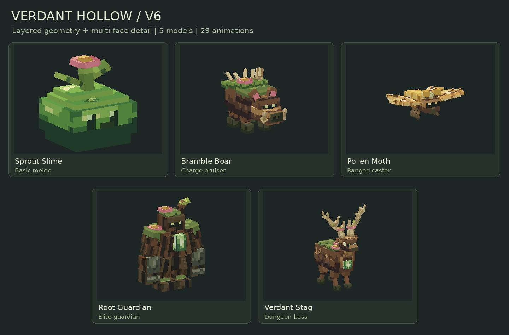

# Blockbench Texture Artist V6

AI agent skill for editable Minecraft Blockbench models, native per-face pixel UVs, humanoid and organic shape design, combat animation, geometry integrity and multi-face readability. Intended workflow: Blockbench + ModelEngine 4 (runtime compatibility must be tested).



## Installation
Import `blockbench-texture-artist.zip` into a skill-compatible agent or supply the folder with `SKILL.md`, `references/`, and `scripts/` as task context. Follow the mandatory V6 and V5 gates; producing a concept image is not a substitute for an editable `.bbmodel`.

## Checks
```bash
pip install -r requirements.txt
python -m unittest discover -s scripts -p 'test_*.py' -v
python scripts/check_uv.py MODEL.bbmodel
python scripts/check_z_fighting.py MODEL.bbmodel --hz 20 --strict-near
python scripts/check_interpenetration.py MODEL.bbmodel --policy surface_policy.json --hz 20
python scripts/check_attachment.py MODEL.bbmodel --policy attachment_policy.json --hz 20
python scripts/check_multiface_readability.py MODEL.bbmodel --policy surface_policy.json
```

Use the example policies as examples only; create appropriate named surfaces and supports for each new model. All-face penetration at rest, configured protected-face checks in sampled animation, affine box SAT support-gap checks and selected-face texture heuristics. A clean numeric report does not establish visibility, texture artistry or engine compatibility. See [example notes](examples/meadow-dungeon-v6/README.md) and [changelog](CHANGELOG.md). 11 local tests passed; GitHub Actions supplied, not run remotely. No license assigned; confirm distribution rights before publishing.

## 한국어
V6에서는 Z-fighting 검사에 더해 입체 관통, 장식 부착 및 다면 텍스처 가독성 검수를 추가합니다. `SKILL.md`를 읽고 대상별 정책을 지정하며, 실제 렌더링 검수 및 런타임 테스트를 별도로 진행합니다. 초원 몬스터 예제 5종 및 검수 기록을 포함합니다.
