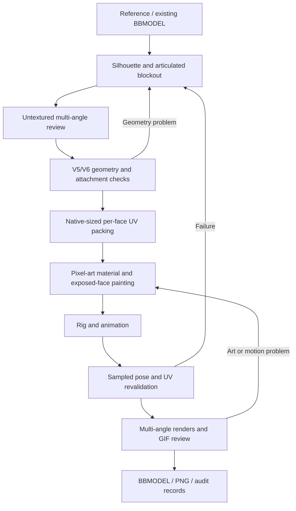
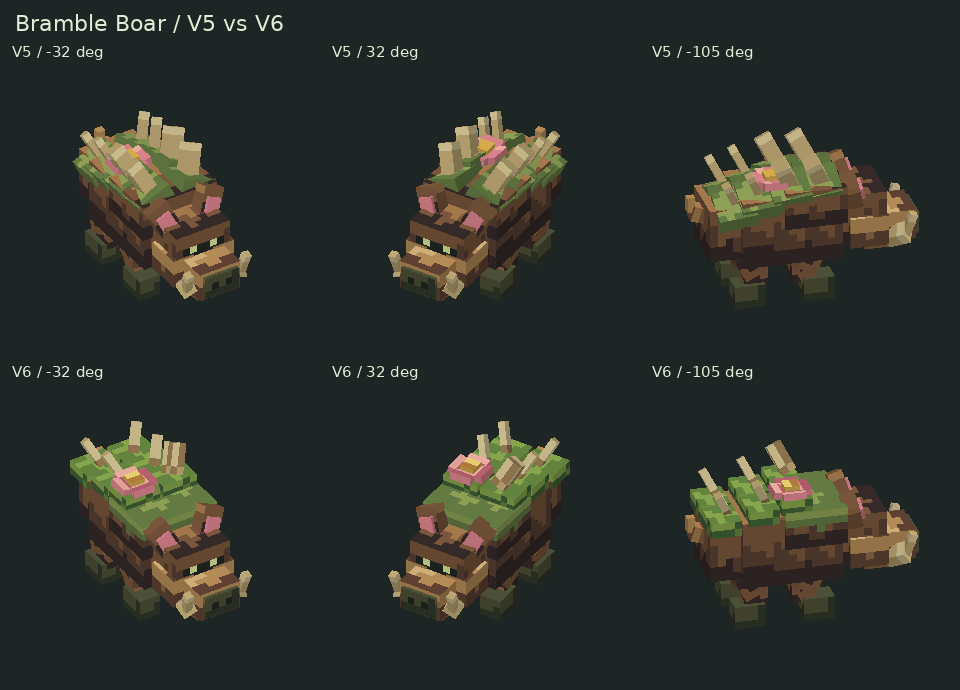

# Blockbench Texture Artist V6

**English** · [한국어 전체 설명](README.ko.md) · [Changelog](CHANGELOG.md) · [Download skill](blockbench-texture-artist.zip)

An AI agent skill for creating, revising and validating editable Minecraft Blockbench models: creatures, bosses, humanoids, weapons and equipment. It combines silhouette design, native-sized per-face UVs, pixel-art materials, skeletal animation, geometry integrity and multi-face readability.


> This project is a set of agent instructions, reference documents and Python validation tools, not a Blockbench plugin or a standalone automatic model generator. A concept image is not a substitute for an editable `.bbmodel`.

## Contents

- [Production philosophy and workflow](#production-philosophy-and-workflow)
- [1. Geometry, anatomy and rigging](#1-geometry-anatomy-and-rigging)
- [2. Per-face UV mapping](#2-per-face-uv-mapping)
- [3. Pixel art and multi-face readability](#3-pixel-art-and-multi-face-readability)
- [4. Weapons and combat animation](#4-weapons-and-combat-animation)
- [5. Z-fighting detection](#5-z-fighting-detection)
- [6. Surface penetration and attachments](#6-surface-penetration-and-attachments)
- [7. Installation and validation](#7-installation-and-validation)
- [8. Example pack and audit results](#8-example-pack-and-audit-results)
- [9. Limitations and distribution](#9-limitations-and-distribution)

## Production philosophy and workflow

Start with a readable silhouette, then build material and detail. Neither the number of cubes, UV reuse percentage nor a clean numerical report is a substitute for good art. Preserve requested proportions, material identity, original animation and functional joints. Back up input assets before modifying them.



## 1. Geometry, anatomy and rigging

### Detail hierarchy

| Level | Purpose | Examples |
|---|---|---|
| Primary | Silhouette and main volumes | torso, head, abdomen, cape |
| Secondary | Functional and visible structure | joints, horns, plates, grip, settings |
| Tertiary | Surface detail | engravings, runes, grain, fur, wear |

Humanoids need separate ribcage, waist and pelvis volumes, meaningful front-to-back depth, and anatomically appropriate joint locations. Six to eight heads is a starting reference, not a universal rule; adapt to the requested character. Creatures must follow their own anatomy and locomotion. Do not make a tall figure by stretching every cube vertically.

For cloth, establish anchor points and drape direction first. Use broad connected panels with changing widths, depths and angles; paint most folds and seams rather than building parallel rods. Branches and horns should taper from a connected base to the tip.

**Anti-line-cube rule:** sort local dimensions as `a ≤ b ≤ c`. Flag a cube for visual review when `c ≥ 12` model units and `c/b ≥ 3`. For cloth-like names, a ratio of 4 or more raises a stronger warning. Functional long parts, including blades, staffs and appropriate limbs, can be justified. These are art heuristics, not engine limits.

Attach parts to the correct moving bone and locate pivots at joints or attachment centers. Preserve UUIDs, parent relationships, and tracks when revising existing assets. Never restore an ornament under root merely to make it visible. Review the untextured model from front, side, rear and three-quarter views before painting.

## 2. Per-face UV mapping

### Native dimensions and texel density

With local cube dimensions `X × Y × Z`, the default density is **one texel per model unit**. UV dimensions derive from the local face, not the rotated world bounding box.

| Face | Dimensions | Example: 8×12×4 cube |
|---|---|---|
| north / south | X × Y | 8×12 px |
| east / west | Z × Y | 4×12 px |
| up / down | X × Z | 8×4 px |

Multiply these dimensions by a common density `d` when another density is required. Swap width and height for 90°/270° UV rotation. Use a common grid for fractional dimensions and document unavoidable exceptions.

### Intentional reuse and atlas packing

Reuse a UV rectangle only when its size, material, orientation and artistic intent match. Symmetric parts may use mirrored UVs if the pattern permits. Directional glyphs, faces and unique wear require their own islands. If a shared tile is edited for one object, create a new island when the other objects need the original image (copy-on-write).

Exact rectangle reuse is permitted; accidental partial overlaps are not. UV overlap is not the same as 3D surface overlap. Reuse and repack first; enlarge the atlas if necessary rather than stretching or shrinking individual faces. Use one-pixel edge padding where possible.

| Setting | Starting recommendation |
|---|---|
| Ordinary creatures | 64×64 or 128×128 atlas |
| Large creatures / bosses | 128×128 or 256×256 atlas |
| Filtering | Nearest Neighbor |
| Output | RGBA PNG; embed in BBMODEL when possible |
| Alpha | Opaque material 255, empty pixels 0; intended transparency requires separate review |

## 3. Pixel art and multi-face readability

Start with a limited 4–7 color ramp per material. Paint base colors, connected value clusters, surface patterns, selective edge/contact shading, then wear and motifs. Use restrained hue shifting and localized baked ambient occlusion. Avoid independent random noise, blurred gradients and outlines on every cube. Record a seed when procedural painting is used.

| Material | Visual treatment |
|---|---|
| Stone | large angular clusters, selective cracks |
| Wood and bone | directional grain, end grain, joint shadows |
| Moss and leaves | irregular patches across edges, veins and darker substrate |
| Metal | selective crisp reflections, edge tones |
| Fabric and leather | low-contrast texture, coherent folds and seams |
| Crystal | facet-specific color planes, highlights and darker edges |

Bright pixels are not actual emissive rendering; special effects depend on the target engine.

### V6 multi-face readability

A focal object should read as a volume, not as a textured sticker. Paint all exposed faces according to their material. Inspect elevated, side, rear and both three-quarter views, plus underside where visible.

- **Flat decal:** paint shallow moss, scars, engravings or veins into the supporting surface.
- **Thin plate:** main motif on the broad face, material cross-section and selective edge shading on narrow sides, appropriate rear/underside shading. Use the available 1–2 texels without enlarging the UV.
- **Solid ornament:** crystal facets, wood end grain, flower undersides and distinct metal surfaces. Add geometry only when it contributes to actual volume, silhouette or motion.

`check_multiface_readability.py` measures color count, luma range and dominant color share on policy-selected `detail_faces`. In the implementation, eligible faces (at least four opaque/nonzero-alpha texels and the relevant dimension condition) are flagged when monochrome, below a luma range of 8, or above 95% dominant-color coverage. Deliberate flat areas and tiny faces can be valid. Do not add random pixels just to pass. These statistics do not prove material quality, edge continuity or screen visibility.

## 4. Weapons and combat animation

Design the weapon's primary silhouette, secondary structure (grip, guard, fittings, gem socket) and tertiary surface details (runes, engraving, wear). Keep shallow details in the texture and use geometry for actual protrusions. Inspect the rear and sides for unjustified support cubes. Distinguish metal frames, cores, leather and other materials.

```text
torso
└── upper_arm
    └── forearm
        └── hand
            └── weapon
                └── optional_core_or_decoration
```

The wrist pivot is the wrist joint; the weapon pivot is the grip center. They need not be identical. Align the hand with the grip, blade and cutting-edge axes. Use the parent inverse rotation to solve local orientation. Two-handed weapons require both contact points. When appropriate, solve IK and bake the result into keyframes; this repository is not a general-purpose IK or Mixamo retargeting tool.

| Phase | Animation principle |
|---|---|
| Anticipation | readable windup and weight shift |
| Strike | plan the weapon path, then accelerate into contact |
| Follow-through | inertia, pelvis/torso rotation and delayed cloth response |
| Recovery | regain balance and return to a compatible guard |

A sword's lowered guard should not look like a staff held upright. Plan weapon trajectories before arbitrary arm rotations. Keep supporting feet planted during stance and account for weight, wrist limits, blade-tip and edge alignment. Inspect at least 20 Hz plus keyframes, with denser sampling for fast strikes. Review actual animated previews and transitions when possible. Distinguish observed reference frames, actual motion retargeting and independently authored approximations; a catalog title alone is not motion data.

## 5. Z-fighting detection

Overlapping coplanar or near-coplanar surfaces may compete in the depth buffer and flicker. V5 checks transformed faces rather than just intersecting unrotated AABBs.

1. Construct the eight corners and textured faces of each cube. Apply local pivot rotation and hierarchical numeric animation transforms.
2. Use AABBs as a broad-phase filter, then evaluate face normals and plane distances.
3. Project nearly parallel faces onto a common plane and clip the convex polygons to compute positive overlap area.
4. Classify same-facing exact overlaps, near-parallel overlaps and opposing contacts separately. Repeat for the rest pose and sampled animations.

| Analysis threshold | Default |
|---|---|
| Exact plane distance | ≤ 0.0001 model unit |
| Near plane distance | ≤ 0.10 model unit |
| Parallel/antiparallel normal tolerance | within 0.1° |
| Positive projected area | > 0.00001 square model units |

These are conservative review thresholds, not universal GPU safety margins. Opposing faces may be hidden structural contact; they require separate review. Correct the specific geometry instead of shifting all parts by a uniform epsilon. Redesign cross-sections and surface ownership where necessary, and repack UVs whenever local dimensions change.

## 6. Surface penetration and attachments

A body can break through a sloped armor plate without being coplanar. V6 adds face/solid coverage and attachment checks while retaining V5.



### 6.1 Surface penetration

Build a local basis from the three transformed solid edges and use its inverse to map another cube's face to the unit box. Clip the polygon against the six interior half-spaces. The clipped area divided by the original area gives the **pairwise surface coverage fraction**. Affine transformations account for rotation and numeric nonuniform scaling. The result does not compute union coverage or actual rendered visibility.

At rest, inspect all textured faces. During sampled animation, inspect explicitly configured `protected_faces`. A plate may embed its underside into its support, but the intended outward surface must remain readable. Named roots of spikes and blossoms can be allowed on the corresponding surface. Do not blanket-exempt the whole body. A fully covered face is not necessarily removable if it is part of a moving joint.

Example excerpt from the supplied boar policy:

```json
{
  "bramble_plate_-1_2": {
    "protected_faces": ["up"],
    "allow": {"up": ["thorn_-1_2"]},
    "detail_faces": ["north", "south", "east", "west", "up"]
  }
}
```

Define model-specific policies using real, unique cube names. An empty policy is not a validation pass.

### 6.2 Attachment integrity — Separating Axis Theorem (SAT)

Moving an ornament to avoid penetration can leave it floating. The attachment checker projects two transformed boxes onto candidate face-normal and edge-cross-product axes. A positive separating axis gap above the default tolerance of 0.08 model unit is reported. This is an axis-projected gap, not a Euclidean closest distance or a physical support simulation.

```json
{
  "thorn_-1_2": ["bramble_plate_-1_2"]
}
```

The checker tests contact against explicitly named alternative supports; it does not infer supports for every cube. Review the intended contact patch, bone hierarchy, pivots and movement visually. Prefer appropriate supporting shapes, stepped volumes or texture integration over unnecessary layered geometry.

## 7. Installation and validation

Target workflow: Minecraft Java Edition, Paper 1.21.4, ModelEngine 4 and Blockbench. Actual compatibility must be tested. The validation tools use Python, NumPy, SciPy and Pillow; CI is configured for Python 3.11.

Import [the skill ZIP](blockbench-texture-artist.zip) into a compatible agent, or supply `SKILL.md`, `references/` and `scripts/` together as task context. Installation depends on the agent environment. Example prompt:

> Use Blockbench Texture Artist V6 to create an editable monster BBMODEL from my reference. Preserve native per-face UV density and intentional sharing, include animations and V5/V6 audit reports, and disclose any untested runtime behavior.

Run these commands from the repository root; the actual sample model and policies are included:

```bash
python -m pip install -r requirements.txt
python -m unittest discover -s scripts -p 'test_*.py' -v
python scripts/check_geometry.py examples/meadow-dungeon-v6/thorn_boar/thorn_boar.bbmodel
python scripts/check_uv.py examples/meadow-dungeon-v6/thorn_boar/thorn_boar.bbmodel
python scripts/check_z_fighting.py examples/meadow-dungeon-v6/thorn_boar/thorn_boar.bbmodel --hz 20 --strict-near
python scripts/check_interpenetration.py examples/meadow-dungeon-v6/thorn_boar/thorn_boar.bbmodel --policy examples/meadow-dungeon-v6/thorn_boar/surface_policy.json --hz 20
python scripts/check_attachment.py examples/meadow-dungeon-v6/thorn_boar/thorn_boar.bbmodel --policy examples/meadow-dungeon-v6/thorn_boar/attachment_policy.json --hz 20
python scripts/check_multiface_readability.py examples/meadow-dungeon-v6/thorn_boar/thorn_boar.bbmodel --policy examples/meadow-dungeon-v6/thorn_boar/surface_policy.json
```

Use `--output report.json` to save a report. Omitting `--hz` on the V5/V6 geometric checks restricts them to the rest pose. For armed models, additionally run `python scripts/check_weapon_grip.py MODEL.bbmodel --config CONFIG.json --hz 20` using a model-specific version of the [grip config example](references/grip-config.example.json).

| Tool | Scope |
|---|---|
| `check_geometry.py` | local long/thin proportions and name-based cloth heuristic |
| `check_uv.py` | integer UVs, native dimensions, density, bounds, references, partial overlap |
| `check_weapon_grip.py` | numerical grip, weapon axis, ground and OBB review |
| `check_z_fighting.py` | transformed-face coplanar/near-parallel candidates |
| `check_interpenetration.py` | all textured faces at rest; protected faces in sampled animation |
| `check_attachment.py` | separation against configured support boxes |
| `check_multiface_readability.py` | selected-face color and luma heuristics |

Some tools emit warnings only in the JSON report. A zero exit code is not a universal approval. Inspect `unsupported`, `issues`, `warnings`, `errors` and the policy scope.

### Repository layout

```text
SKILL.md                         # mandatory agent workflow
references/                      # detailed design and QA guidelines
scripts/                         # validation tools and unit tests
examples/meadow-dungeon-v6/       # models, textures, GIFs, policies and audits
.github/workflows/tests.yml       # CI unit test configuration
requirements.txt
blockbench-texture-artist.zip     # importable skill package
```

## 8. Example pack and audit results

[Verdant Hollow — Meadow Dungeon I](examples/meadow-dungeon-v6/README.md) includes five editable models and 29 animation clips. Separate PNGs, previews, walk/attack GIFs and model-specific audit policies are provided.

| Creature | Cubes | Clips | Design |
|---|---:|---:|---|
| [Sprout Slime](examples/meadow-dungeon-v6/meadow_slime/) | 12 | 5 | hopping, leaf edges |
| [Bramble Boar](examples/meadow-dungeon-v6/thorn_boar/) | 53 | 6 | separated dorsal armor, charge |
| [Pollen Moth](examples/meadow-dungeon-v6/pollen_moth/) | 34 | 6 | independent wings, flight |
| [Root Guardian](examples/meadow-dungeon-v6/root_guardian/) | 49 | 6 | right-arm sweep, painted moss |
| [Verdant Stag](examples/meadow-dungeon-v6/verdant_stag/) | 90 | 6 | dorsal ornaments, chest gem, antlers |

### Recorded V6 results

From the included [validation report](examples/meadow-dungeon-v6/validation_all.json):

| Metric | Result |
|---|---:|
| Cubes / textured faces | 238 / 1,428 |
| Unique UV islands / reused faces | 365 / 1,063 (74.4%) |
| Rest and animation pose samples | 1,249 |
| Configured protected faces | 16 |
| Protected surface candidates at rest, before → after | 35 → 0 |
| Sampled same-facing exact/near overlap candidates | 0 |
| Sampled configured protected-face penetration hits | 0 |
| Selected detail faces / heuristic warnings | 400 / 0 |
| Selected attachments / gap warnings | 41 / 0 |
| UV errors | 0 |

These are recorded numerical results, not a claim of complete collision removal. Rest-pose partial/full coverage candidates remain (2,904/82), as do 2,394 opposing-contact hits across samples. Intentional contact and hidden surfaces require review. Slime and moth have no configured protected faces or support entries; do not claim animated penetration or attachment coverage for those unconfigured parts. Animation arrays remain unchanged from V5.

### Evolution of the skill

| Version | Core principle |
|---|---|
| V1 | pixel clustering, native UVs and intentional reuse |
| V2 | anatomy, drapery, anti-line-cube design |
| V3 | weapon detail hierarchy, grip and wrist structure |
| V3.1 | focal prop material and rear silhouette |
| V4 | weapon-led choreography, stance and motion timing |
| V5 | transformed-face overlap and geometry integrity |
| V6 | surface penetration, attachment and multi-face readability |

## 9. Limitations and distribution

The checkers find numerical candidates using an approximate numeric-linear XYZ Euler transform convention. Nonlinear interpolation, Molang, non-cube geometry and inflate/rescale are unsupported by the V5/V6 evaluator. The grip tool has additional scale limitations. Continuous-time intersections, animation blends, real visibility, alpha cutouts, shader behavior and depth-buffer precision at different camera distances require separate tests.

Example renders use a custom software renderer; actual Blockbench and ModelEngine runtime compatibility has not been verified. Eleven local unit tests were previously recorded as passing; the provided GitHub Actions workflow is not evidence of a remote CI run. MythicMobs combat configurations and emissive effects are not included.

Read the detailed instructions: [SKILL.md](SKILL.md), [geometry integrity](references/geometry-integrity.md), [surface penetration](references/surface-penetration.md), [multi-face readability](references/multiface-readability.md), [weapon design](references/weapon-design.md), [grip and pose](references/weapon-grip-and-pose.md), [combat choreography](references/combat-stance-and-choreography.md), [animation QA](references/animation-principles.md).

No license has been assigned. Confirm distribution rights and choose a license before publishing or redistributing the materials.
