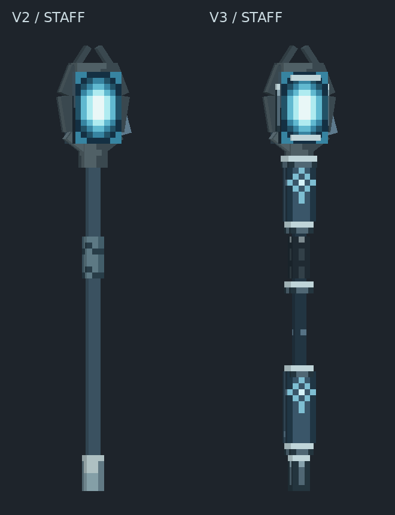
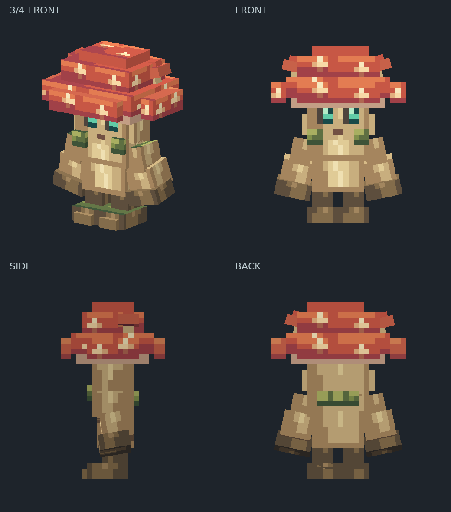

# Blockbench Texture Artist

**AI agent skill for Minecraft pixel-art textures, per-face UV mapping, and editable Blockbench models.**

Minecraft 몬스터, 보스, 장비의 픽셀 아트 텍스처와 UV 매핑 품질을 높이기 위한 AI 에이전트용 스킬입니다. 레퍼런스 이미지 또는 기존 `.bbmodel` 파일을 기반으로, 실제 편집 가능한 모델과 텍스처를 제작·수정·검수하는 작업 지침을 제공합니다.

[English overview](#english-overview) · [SKILL.md](SKILL.md) · [스킬 ZIP 다운로드](blockbench-texture-artist.zip) · [제작 예제](examples/mushroom-spirit/)

## v3 — Weapon design and grip

무기 문양, 파지 기준점, 손목 본, 공격 방향 보정과 20Hz 애니메이션 검사를 추가했습니다. V2의 형태/UV 규칙을 유지합니다.



[Frost Witch V3 BBMODEL](examples/frost-witch-v3/frost_witch_v3.bbmodel) · [애니메이션 검수](examples/frost-witch-v3/frost_witch_v3_animation_review.json)

```bash
python -m pip install -r requirements.txt
python scripts/check_uv.py examples/frost-witch-v3/frost_witch_v3.bbmodel
python scripts/check_weapon_grip.py examples/frost-witch-v3/frost_witch_v3.bbmodel --config examples/frost-witch-v3/frost_witch_v3_grip.json
```

The animation checker approximates numeric linear XYZ Euler animation; it does not validate actual ModelEngine runtime.

## Preview

### Mushroom Spirit / 버섯 정령



| Model | Texture | Preview |
| --- | --- | --- |
| [BBMODEL](examples/mushroom-spirit/mushroom_spirit.bbmodel) | [PNG](examples/mushroom-spirit/mushroom_spirit.png) | [PNG](examples/mushroom-spirit/mushroom_spirit_preview.png) |

## v2 — 모델링 품질 개선

인간형 비례와 관절, 넓은 천 덩어리 기반 망토/로브, 장척 라인 큐브 제한, 무텍스처 실루엣 검수 규칙을 추가했습니다. 기존 UV 규칙은 유지합니다. `python scripts/check_geometry.py model.bbmodel`로 검토 후보를 확인할 수 있습니다. 자동 검사는 미술 검수나 엔진 호환성 검사를 대체하지 않습니다. [변경 사항](CHANGELOG.md). 기존 버섯 정령 예제는 v1 제작 결과입니다.

## 주요 기능

- **Per-face UV**: 큐브의 실제 로컬 면 치수에 맞춰 UV 영역을 설계합니다.
- **UV 재사용**: 크기, 재질, 표면 방향, 패턴이 호환되는 면은 동일한 UV 영역을 공유합니다. 얼굴이나 방향성이 있는 문양은 별도 영역을 사용합니다.
- **Texel density**: 기본 1 model unit : 1 texel을 유지하고, 공간 부족을 이유로 개별 면을 임의로 늘리거나 축소하지 않습니다.
- **Pixel art**: 픽셀 군집, 제한적인 색상 램프, hue shifting, 국소 AO를 활용하여 과도한 노이즈와 흐릿한 명암을 피합니다.
- **Atlas packing**: UV 중복 제거, 패킹 최적화, 가능한 경우 1px 패딩 및 가장자리 색상 확장을 적용합니다.
- **Model preservation**: 기존 모델의 UUID, 본 구조, 애니메이션과 메타데이터를 가능한 한 보존합니다.
- **Validation**: 면별 UV 크기, 아틀라스 범위, 중첩, 알파 및 텍스처 참조를 검사하고 실제 렌더링·런타임 검증 여부를 구분합니다.

## UV 설계 원칙

큐브 로컬 치수가 `X × Y × Z`이고 기본 픽셀 밀도가 1일 때:

| Face | UV size |
| --- | --- |
| North / South | X × Y |
| East / West | Z × Y |
| Up / Down | X × Z |

예를 들어 `8 × 12 × 4` 큐브의 면은 각각 `8 × 12`, `4 × 12`, `8 × 4` 픽셀로 매핑합니다. UV를 90° 또는 270° 회전하면 폭과 높이의 대응이 바뀝니다. 동일한 크기의 반대편 면도 재질과 그림 방향이 호환되는 경우에만 재사용합니다.

아틀라스가 부족할 때는 UV 재사용 → 패킹 최적화 → 아틀라스 해상도 확대 순으로 해결합니다.

## 권장 제작 설정

| 항목 | 기본값 |
| --- | --- |
| 일반 몬스터 | 64×64 또는 128×128 |
| 대형 몬스터 / 보스 | 128×128 또는 256×256 |
| 픽셀 밀도 | 1 unit : 1 texel부터 시작 |
| 재질별 기본 팔레트 | 4–7색 |
| 필터 | Nearest Neighbor |
| 출력 | `.bbmodel`, RGBA `.png`, 가능한 경우 렌더링 및 검증 결과 |
| 대상 환경 | Minecraft Paper 1.21.4 / ModelEngine 4 / Blockbench (사용자 설정 우선) |

## 설치 및 사용

1. 이 저장소의 [스킬 ZIP](blockbench-texture-artist.zip)을 다운로드합니다. 또는 저장소를 복제한 후 `SKILL.md`를 사용합니다.
2. 사용자 정의 스킬 업로드를 지원하는 AI 환경에서 ZIP을 등록합니다. 로컬 스킬을 지원하는 환경에서는 해당 환경의 스킬 디렉터리 규칙에 따라 `SKILL.md`를 배치합니다.
3. 레퍼런스 이미지 또는 기존 `.bbmodel`을 첨부하고 원하는 모델, 아틀라스 크기, 대상 엔진, 수정 범위를 지정합니다.

등록 방식과 파일 생성 기능은 사용하는 AI 환경에 따라 다릅니다. 스킬은 작업 지침이며, 그 자체로 실행되는 Blockbench 플러그인이나 모델 생성 프로그램은 아닙니다. 실제 파일 제작에는 AI 환경의 코드 실행·파일 생성 기능 또는 적절한 모델링 도구가 필요합니다.

### 프롬프트 예시

```text
Blockbench Texture Artist 스킬을 사용해서 숲속 버섯 정령 몬스터를 제작해줘.
Minecraft 1.21.4 / ModelEngine 4를 대상으로 하고, 128×128 텍스처 아틀라스를 우선 사용해줘.
개별 면의 UV 크기를 큐브의 로컬 치수에 맞추고, 재사용 가능한 면은 동일 UV를 공유해줘.
개별 UV를 늘리거나 압축하지 말고, 과도한 픽셀 노이즈와 반투명 픽셀을 피해줘.
편집 가능한 bbmodel, PNG 텍스처, 미리보기 및 검증 결과를 제공해줘.
```

## 저장소 구조

```text
blockbench-texture-artist/
├── README.md
├── SKILL.md
├── CHANGELOG.md
├── scripts/check_geometry.py
├── blockbench-texture-artist.zip
└── examples/
    └── mushroom-spirit/
        ├── mushroom_spirit.bbmodel
        ├── mushroom_spirit.png
        └── mushroom_spirit_preview.png
```

## 검증 범위 및 제한

스킬은 UV·텍스처 품질을 위한 워크플로를 정의합니다. 모델의 실제 품질과 기능은 사용한 AI 및 도구에 따라 달라집니다. 예제의 Blockbench 및 ModelEngine 4 인게임 호환성은 실제 실행으로 확인되지 않았습니다. 레퍼런스에 보이지 않는 부분은 추정하여 제작될 수 있습니다. 이 저장소는 공식 Blockbench 또는 ModelEngine 프로젝트가 아닙니다.

## Contributing

UV 매핑 오류, 텍스처 품질 개선, 재질 프리셋, 제작 예제 및 검증 절차 관련 Issue와 Pull Request를 환영합니다. 버그 보고 시 가능하면 대상 버전, 원본 모델, 기대 결과, 실제 결과를 함께 첨부해주세요. 제3자의 모델이나 텍스처는 배포 권한을 확인한 경우에만 제출해주세요.

## English overview

Blockbench Texture Artist is an AI-agent skill for creating and revising Minecraft entity, monster, boss and equipment textures and editable Blockbench models, with a focus on ModelEngine 4 workflows.

It prioritizes consistent texel density, dimension-matched per-face UVs, intentional UV reuse, pixel clustering, controlled material palettes, atlas packing and explicit validation. Existing model hierarchies and animations should be preserved unless changes are requested. The skill is an instruction set, not a standalone generator or a Blockbench plugin. File-generation and runtime capabilities depend on the host environment.

To use it, download the skill ZIP or place `SKILL.md` in the skill location supported by your AI environment. Attach a reference image or `.bbmodel`, specify your target environment and request the required output files. The example has not been runtime-tested in Blockbench or ModelEngine 4.


**Update:** v3.1 refines focal weapon rendering by improving lantern/core texture readability and removing awkward rear support cubes from the Frost Witch staff example.
